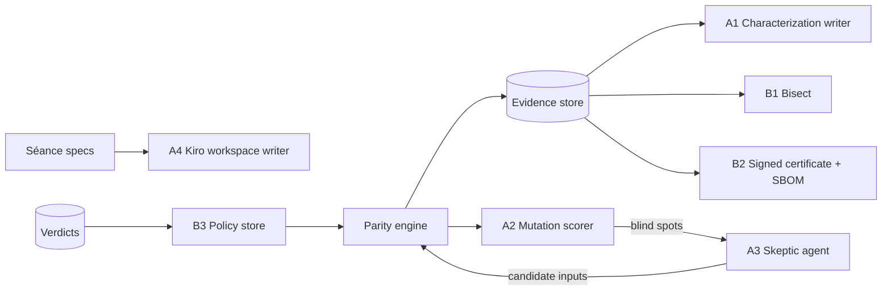

# Necromancer: Advanced Features

Extends `docs/SOLUTION.md`. These features are what lift the project from "a good tool" to something judges remember. The risk is scope: **a solo build cannot ship all of them in four weeks.** Features are therefore tiered, with effort estimates (ideal dev-days, my judgment) and the score criterion each one moves.

Rule of thumb: ship the core (SOLUTION.md section 12) first. Add Tier A features only after the Nov 10 spike passes. Tier B only if Tier A is stable by Nov 24. Tier C is written down for the roadmap slide, not for building.

---

## Summary

| ID | Feature | Tier | Days | Moves | Needs |
|---|---|---|---|---|---|
| A1 | Characterization-test generation ("Ghost memory") | A | 3 | Impact, Tech | parity engine |
| A2 | Proof strength via mutation testing | A | 3 | Tech, Innovation | A1 or parity engine |
| A3 | Skeptic agent: LLM-guided adversarial inputs | A | 3 | Innovation, Tech | parity engine, LLM |
| A4 | Kiro workspace handoff (`.kiro/` for the revived repo) | A | 2 | Tech, Presentation | séance |
| B1 | Time-travel bisect ("who killed it") | B | 2 | Tech, Impact | reanimator commits |
| B2 | Signed resurrection certificate + SBOM | B | 2 | Impact, Innovation | report |
| B3 | Policy learning from human verdicts | B | 2 | Innovation | verdicts |
| B4 | CVE reachability + performance parity | B | 3 | Impact | autopsy, parity |
| B5 | Public API diff and compatibility shims | B | 3 | Impact | AST tooling |
| C1 | Graveyard scanner and fleet queue | C | 4 | Impact, Presentation | exhume |
| C2 | Dependency-chain resurrection | C | 5 | Innovation | everything |
| C3 | Multi-language adapters (TS via fast-check) | C | 6 | Impact | parity protocol |
| C4 | "Keep it alive" GitHub Action | C | 3 | Impact | parity, report |

Tier A is about 11 days, which fits the plan only if the core lands by Nov 18.

---

## Tier A: build these (the differentiators)

### A1. Characterization-test generation ("Ghost memory")
**Idea.** The parity run produces a lot of old-vs-new evidence. Freeze it: emit a committed pytest suite (`tests/characterization/`) of Hypothesis-seeded examples with the *original's* outputs as expected values. The revived repo now has a regression net the dead project never had.

**How.**
- Record `(callable, args, old_result)` triples from the parity run (deduplicated, minimal, fixed seeds).
- Render as readable parametrised pytest files with a header comment: why these cases, original version, seed, regeneration command.
- Exclude NONDETERMINISTIC and human-marked "intentional" divergences (which become documented expected changes).

**Why it wins.** Tangible deliverable maintainers keep; turns a one-off proof into lasting value.
**Kiro angle.** A hook regenerates the suite when specs change; PBT property: "every generated test passes against the original".
**Demo moment.** Revived repo's test count jumps from 12 to 400+, all green.
**Risks.** Large or unstable outputs; cap sizes and use stable `repr` normalisers.

### A2. Proof strength via mutation testing
**Idea.** A parity score alone can be fooled by weak inputs. Measure how good the proof is: mutate the *revived* code (flip operators, change constants, drop branches) and check whether the parity suite catches each mutant. Report a **proof strength** (mutants killed / viable mutants) next to parity and coverage.

**How.**
- Use an existing mutation tool (e.g. `mutmut` or `cosmic-ray`) on modules the parity suite reaches; sample mutants to bound runtime.
- Surviving mutants become "blind spots" listed in the report with the function they live in; optionally feed them to A3 as targets.

**Why it wins.** Honest, quantitative answer to "how do I know the proof means anything?" Few hackathon projects test their own tester.
**Kiro angle.** PBT showcase: the parity engine's own mutation self-test (inject known bug, assert it is caught) is already in the testing strategy; this extends it to user repos.
**Demo moment.** "Parity 97%, proof strength 81%: here are the 6 blind spots."
**Risks.** Mutation runs are slow; use sampling, per-function timeouts, a time budget flag.

### A3. Skeptic agent: LLM-guided adversarial inputs
**Idea.** Hypothesis is good at structure but blind to domain edge cases (leap days, Unicode normalisation, locale quirks). A **Skeptic** agent reads source, docstrings and issues, then proposes adversarial inputs; the parity engine executes them. The LLM never decides correctness; it only proposes inputs, and the deterministic engine judges.

**How.**
- For each uncovered or low-yield callable, prompt the Skeptic with signature, docstring, linked issues, and survivors from A2. It returns candidate arguments as Python literals (validated with `ast.literal_eval` or a restricted constructor whitelist).
- Run candidates through both environments; keep any DIVERGENT result as a haunting tagged `source: skeptic`.
- Budget governor: max tokens per callable, cache by content hash, `--no-llm` disables the feature without changing results of the rest.

**Why it wins.** Hybrid of fuzzing and LLM reasoning with a clean trust boundary, which is also a good "thoughtful strategy to AI development" story for the Kiro criterion.
**Kiro angle.** A custom agent (`skeptic`) with narrow tools and steering that forbids judging; documented as a custom-agent experiment.
**Risks.** Hallucinated inputs that don't type-check; validation step drops them and counts the drop rate in the report.

### A4. Kiro workspace handoff
**Idea.** Leave behind a revived repo that is ready for the next maintainer to continue *with Kiro*. Necromancer writes a `.kiro/` into the revived fork: steering derived from the repo's conventions (style, test layout, how to run parity), the baseline and issue specs already marked with done/deferred tasks, and a hook that runs the characterization suite on save.

**How.**
- Steering generation from autopsy facts (test command, supported Pythons, lint config) plus the migration rules used.
- Specs from séance, with task checkboxes reflecting reanimation results; deferred tasks keep their reasons.
- A `README` section "Continue this resurrection in Kiro".

**Why it wins.** Ties the product tightly to the hackathon's own tool, makes the Kiro usage obvious in the demo repo, and gives the project a clean "what happens after" story.
**Risks.** Low. Keep generated steering short and factual.

---

## Tier B: add if Tier A is stable

### B1. Time-travel bisect ("who killed it")
When a haunting appears, bisect across the reanimation commits (and optionally the original's own history) to find the single change that introduced the divergence; show the diff hunk next to the counterexample. Uses `git bisect run` with a script that re-executes only the failing counterexample. Turns hauntings from "something differs" into "this line did it".

### B2. Signed resurrection certificate and SBOM
- Generate a CycloneDX SBOM for the revived package and diff it against the original's (dependencies removed/upgraded).
- Sign the report JSON (Ed25519 locally; Sigstore keyless if time allows) with embedded image digests, seeds and tool versions, so third parties can verify and reproduce.
- UI shows a "verified reproducible" badge only if a clean re-run reproduces the same score.

### B3. Policy learning from human verdicts
Verdicts (`intentional`/`regression`) become rules in `.necromancer/policy.yml` (e.g. "ValueError to TypeError on invalid input is intentional for module X"). Future runs apply the policy and only surface new kinds of divergence. Policies are reviewable text, never hidden model state. Measure: hauntings shown on a re-run drop after verdicts.

### B4. CVE reachability and performance parity
- **Reachability:** use static call graph from the public API to the vulnerable function named in an OSV advisory; rank advisories as *reachable* vs *present-only* so the report doesn't cry wolf.
- **Performance parity:** record per-call timing in both workers; flag callables where new/old exceeds a configurable ratio on matched inputs. Report as a separate axis, never mixed into correctness parity.

### B5. Public API diff and compatibility shims
AST-based public API snapshot of old vs new (names, signatures, defaults); classify changes as additive, breaking, or deprecation. For renamed or moved symbols, generate thin deprecation shims (`warnings.warn`) so downstream users do not break, and verify with parity that the shim returns the same results.

---

## Tier C: roadmap (describe, don't build)

- **C1. Graveyard scanner and fleet queue.** Rank candidates by revival value (dependents, downloads, CVE count, days dead), run many in a queue, publish a leaderboard. Needs a dependents data source and sensible rate limits.
- **C2. Dependency-chain resurrection.** When a dead library depends on another dead library, recurse (with a depth limit) and show the whole "necropolis" graph with parity at each node.
- **C3. Multi-language adapters.** A parity protocol (`discover`, `generate`, `invoke`, `compare`) that language adapters implement; TypeScript with fast-check first. The Python engine becomes the reference implementation.
- **C4. "Keep it alive" GitHub Action.** Re-runs the characterization suite and parity on dependency PRs, posting a parity delta comment. Prevents re-death.

---

## How the features change the architecture

New components (additive; the core pipeline is unchanged):

Key interface additions:
- `evidence.ndjson`: append-only record of every compared call (callable, input hash, old/new outcome class). One source for A1, A2, B1, B2.
- `blindspots.json`: output of A2, input to A3.
- `policy.yml`: B3; read by the parity classifier before it reports a haunting.
- Report gains a **trust panel**: parity, coverage, proof strength, skeptic yield (new hauntings found by A3 per 100 proposals), reproducibility status.

New MCP tools: `get_proof_strength(run_id)`, `list_blind_spots(run_id)`, `generate_characterization_tests(run_id)`, `export_kiro_workspace(run_id)`.

New Kiro specs (one each, small): `characterization`, `proof-strength`, `skeptic`, `kiro-handoff`. Each follows the same requirements, design, tasks shape, which also adds to the specs-in-practice story.

---

## Property-based tests to write for these features

| Feature | Property |
|---|---|
| A1 | Every generated characterization test passes against the original environment (round-trip) |
| A1 | Regenerating with the same seed yields byte-identical files |
| A2 | An injected known bug in a fixture is always reported as a surviving or killed mutant consistently (no flakiness over repeated runs with the same seed) |
| A3 | The Skeptic can never change a verdict: for any candidate set, results equal the deterministic engine's results on those inputs |
| A3 | Invalid candidate literals are always rejected, never executed |
| A4 | Generated `.kiro/specs` tasks count equals reanimation task count (done + deferred) |
| B2 | Verifying a signed certificate fails for any single-byte modification |
| B3 | Applying a policy never hides a divergence that has no matching rule |

---

## Revised schedule if Tier A is included

| Window | Core | Advanced |
|---|---|---|
| Nov 6-11 | Scaffold, steering, parity engine, spike | none |
| Nov 12-18 | Autopsy, sandbox, reanimator, MCP v0 | A1 once parity is stable |
| Nov 19-25 | Séance, Crypt UI replay | A2, A4 |
| Nov 26-29 | Demo bundles, polish | A3 only if everything else is green |
| Nov 30-Dec 3 | Video, write-up, blog, submit | none (freeze Nov 29) |

If anything slips, cut in this order: A3, then A2, then B-tier. Keep A1 and A4: they are cheap and visibly useful.

---

## Pitch lines these features unlock

- "We don't just claim it still works: we ship the tests that prove it, **and a score for how much to trust that proof**."
- "The LLM proposes, the deterministic engine disposes."
- "Every revived repo comes with a Kiro workspace, so the next maintainer continues where we stopped."
