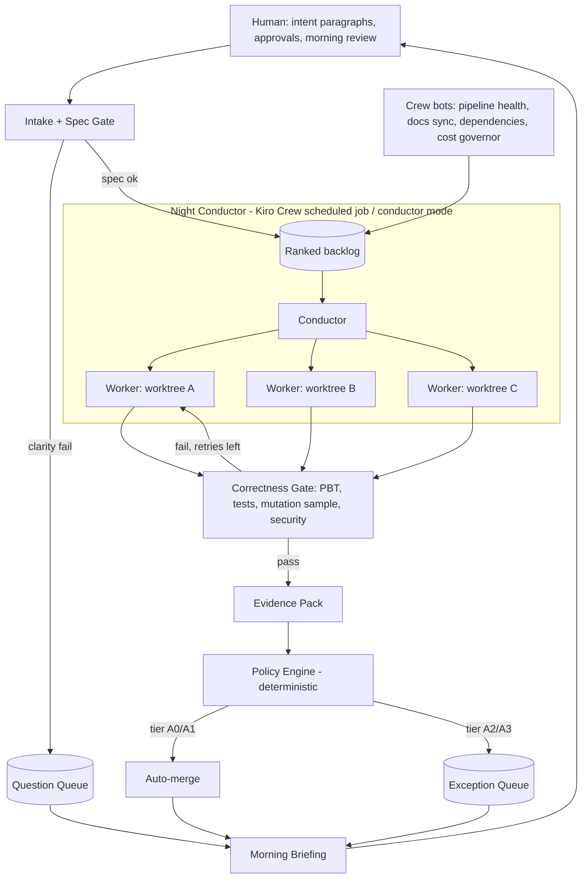

# Night Shift: an AI-native engineering org in a box

> **A skeleton crew of AI agents that ships while your org sleeps.**
> Category: **Skeleton Crew** (one skeleton, two distinct apps: one **Resurrection**, one **Frankenstein**), plus a separate **Kiro Crew app** repo for the Best Kiro Crew App bonus.

Grounded in: Kiro's *Frontier teams* page (https://kiro.dev/topics/frontier-teams/), the Kiro Crew docs (bots, conductor mode, scheduled jobs), and the Kiro CLI docs (headless mode, custom agents, workflows, hooks, steering). Written 2026-11-25; **9 days to Dec 4**.

---

## 1. Thesis

The frontier-teams page says high-performing teams share five practices. Night Shift turns each into code you can clone, so an enterprise can adopt the *operating model*, not just a tool.

| Frontier practice (from the page) | Night Shift mechanism |
|---|---|
| **Invest in agent context** (steering files, persistent memory) | `org/steering/` golden rules (security, testing, release, style) applied to every surface; bots keep their own memory |
| **Make intent explicit before code** (specs, clarity detection) | **Spec Gate**: no build starts until requirements have EARS acceptance criteria and a clarity check passes; ambiguity goes to a question queue |
| **Feed agents, don't babysit** (backlog, parallel agents, overnight runs, async review) | **Night Conductor**: a nightly Crew job drains a ranked backlog into parallel worktrees via headless Kiro CLI; humans review in the morning |
| **Shift testing left** (agents self-correct against tests) | **Correctness Gate**: property-based tests derived from requirements, contract tests, mutation sample, security scan; agent retries until green or escalates |
| **Slow down to speed up / org-wide governance** | **Autonomy Policy**: risk-tiered rules decide what may merge with zero humans; everything else waits in an exception queue |

**Headline claim, and the only one we make:** measured **Human Touch Index** over real runs: percentage of tasks delivered with zero human edits, interventions per task, and time from intent to merge. Numbers come from our own logs, not from Amazon's. The page's results (4.5x median, up to 20x) are theirs; we cite them as motivation, never as ours.

---

## 2. System overview



Design rules:
- **LLMs write; deterministic code decides.** The merge decision is made by the policy engine from evidence, never by an agent's opinion.
- **Reviewers never share context with builders.** Each review step runs in a fresh session (the Workflows docs describe this property).
- **Every human touch is logged** with a reason code. That log is the data behind the Human Touch Index.

---

## 3. Org as code: the skeleton

The skeleton is intentionally small: configuration plus a thin orchestrator. Everything domain-specific lives in the two apps.

```
night-shift/                      # the skeleton (this is the Skeleton Crew repo root)
├─ .kiro/
│  ├─ steering/                   # org golden rules (product, tech, structure, security, testing, release)
│  ├─ agents/                     # custom agents = org roles (section 4)
│  ├─ specs/_templates/           # requirements/design/tasks templates with EARS + PBT hooks
│  ├─ hooks/                      # spec-gate, test-on-save, secret-scan, evidence-on-done
│  └─ workflows/                  # feature-pipeline.yaml, brownfield-pipeline.yaml, publish-pr
├─ org/
│  ├─ nightshift.yaml             # roles, gates, autonomy tiers, budgets, schedules
│  └─ policies/                   # risk rules (path globs, diff size, API/dep changes)
├─ nightshift/                    # orchestrator (Python, small): CLI wrapping kiro-cli headless
│  ├─ cli.py  conductor.py  worktrees.py  gates.py  policy.py  evidence.py  metrics.py  ledger.py
├─ crew/                          # Kiro Crew bot definitions + schedules (also published as the Crew-app repo)
├─ apps/
│  ├─ lazarus/                    # App 1: Resurrection (brownfield)
│  └─ chimera/                    # App 2: Frankenstein (greenfield)
├─ docs/  tests/  LICENSE  README.md
```

`nightshift.yaml` (illustrative):

```yaml
org: night-shift
budgets: {credits_per_night: 400, per_task_cap: 60}
gates:
  required: [spec_clarity, unit, property, lint, security_scan]
  optional: [mutation_sample, perf_smoke]
retries: 3
autonomy:
  tiers:
    A0: {desc: docs/tests only,           auto_merge: true,  max_diff_lines: 400}
    A1: {desc: internal code, no API/deps, auto_merge: true,  max_diff_lines: 250, needs: [property, review_x2]}
    A2: {desc: public API or dep change,   auto_merge: false, approvals: 1}
    A3: {desc: auth, secrets, infra, data migrations, auto_merge: false, approvals: 2}
  classify_by: [path_globs, public_api_diff, dependency_diff, diff_size]
schedules:
  night_conductor: "0 22 * * *"
  morning_briefing: "0 7 * * 1-5"
  pipeline_health: "*/30 * * * *"
```

---

## 4. Roles = custom agents (each with narrow tools)

| Agent | Responsibility | Tool limits (least privilege) |
|---|---|---|
| `analyst` | Intent to requirements; flags vague terms; proposes defaults | read-only + spec files |
| `architect` | Design and task plan sequenced by dependency | read + design files |
| `builder` | Implements one task in one worktree | write in worktree only, no network |
| `tester` | Derives property-based tests from requirements; mutation sample | write tests only |
| `reviewer` | Independent review against spec and steering (two instances, different focus) | read-only; cannot merge |
| `security` | Dependency, secret, injection, authz review | read-only + scanners |
| `scribe` | Docs, changelog, ADRs kept in sync | write docs only |
| `release` | Builds evidence pack, requests policy decision | read + evidence dir |

Every agent has a steering file stating what it must *not* do. This is documented in the write-up as the custom-agents experiment.

---

## 5. The pipeline (a workflow recipe)

`feature-pipeline.yaml` (generated by Kiro, then committed and reused):

1. **Intake**: `analyst` turns an intent paragraph (or issue) into `requirements.md` (EARS) plus open questions.
2. **Spec Gate** (hook): fails on vague terms, missing acceptance criteria, untestable criteria. Failures go to the **Question Queue** with a *recommended default*. The task is parked, not blocked: if no human answers by morning, the briefing says which default it would take.
3. **Design and plan**: `architect` writes `design.md` and `tasks.md`.
4. **Parallel build**: conductor assigns independent tasks to separate git worktrees; `builder` runs headless (`kiro-cli chat --v3 --no-interactive` with `--trust-tools` scoped to the role, never blanket trust).
5. **Correctness Gate**: `tester` generates property tests from requirements; unit, lint, security scan; retry loop (max 3) feeds failures back to the builder.
6. **Independent review**: two `reviewer` sessions with fresh context.
7. **Evidence Pack** (section 7) and **Policy decision** (section 6).
8. **Merge or escalate**; update ledger and metrics.

`brownfield-pipeline.yaml` replaces step 1 with **codebase analysis → specs for what exists → characterization tests**, then continues as above (this matches the page's brownfield use case).

---

## 6. Autonomy policy (how "minimal human intervention" stays safe)

The policy engine is deterministic code (about 200 lines, heavily property-tested):

- Inputs: changed paths, diff size, public API diff, dependency diff, gate results, review verdicts.
- Output: tier (A0 to A3) and a decision (`merge`, `queue_for_human`, `reject`).
- Escalation is **monotonic**: any single signal can raise the tier, none can lower it. Property test: adding a changed file never decreases the computed tier.
- Kill switch: `nightshift pause` and a file flag stop all schedules; budgets hard-stop the night.
- Auto-merge only to a protected integration branch in the demo repos; nothing here touches production.

---

## 7. Evidence Pack (per task)

A folder attached to the PR: spec links, design diff, task list, test and PBT results with seeds, mutation sample score, security scan output, reviewer verdicts, policy decision with the signals that drove it, credit cost, and the ledger of any human touch. A reviewer should be able to decide in two minutes without opening the code, which is the "review interfaces and architecture, not style" shift from the frontier page.

---

## 8. Crew bots (always-on organisation layer)

Kiro Crew bots are persistent agents with their own memory and workspace, started by schedules or events; they can delegate to workers. Lineup (names ours; confirm configuration options in the app):

| Bot | Trigger | Does | Cannot |
|---|---|---|---|
| **Intake bot** | hourly / on new issue | Sanitises issue text (untrusted input), drafts specs, ranks backlog | merge, close issues |
| **Night Conductor** | nightly | Runs the pipeline over the top N backlog items in parallel | exceed budget |
| **Pipeline health bot** | every 30 min | Separates new failures from known flakes, opens fix tasks | deploy |
| **Dependency / refactor bot** | weekly | Small PRs for dead code and updates, with parity or test evidence | touch A3 areas |
| **Docs-sync bot** | on merge | Updates docs and ADRs to match code | change code |
| **Cost governor** | per run | Tracks credits per task, throttles or pauses | start tasks |
| **Morning briefing bot** | weekday 07:00 | One page: merged overnight, queued for you, questions, spend, Human Touch Index | act on its own |

The Crew repo for the bonus prize (`night-shift-crew`) packages these definitions, schedules and memory seeds with a README; it must be a **new** repo created during the submission period and owned by the same GitHub account.

---

## 9. The two apps from one skeleton

Both are small on purpose: the factory is the product, the apps prove versatility. Each is mostly built **by agents overnight** from intent paragraphs; our human input is logged.

### App 1: **Lazarus** (Resurrection, brownfield)
- **Dead tech:** a 2003-style Perl CGI web bulletin board (written by us, about 300-500 lines, no tests, no docs; deliberately realistic spaghetti). Runs under the system Perl.
- **Flow:** `brownfield-pipeline`: analyst generates specs *for existing behaviour*; characterization tests are recorded by replaying HTTP requests against the legacy app; the modern rewrite (typed Python or TypeScript service) is built task by task; **differential HTTP parity tests** compare old and new on recorded and property-generated requests.
- **Proof:** parity percentage and a list of intentional differences, each justified in the spec.
- **Policy angle:** migrations and auth-related changes land in tier A3 (queued for a human), docs and tests in A0.

### App 2: **Chimera** (Frankenstein, greenfield)
- **Stitch:** a spreadsheet whose cells can be formulas, shell pipelines, or HTTP calls (incompatible worlds: dataflow, Unix pipes, web), recalculated over a dependency graph, with a minimal web UI.
- **Flow:** `feature-pipeline` from one intent paragraph. Property tests: recalculation is order-independent, cycles are detected, shell cells run sandboxed.
- **Policy angle:** shell execution lives under A3 rules; the UI under A1.

Why two different stacks and risk profiles matter: it shows the skeleton adapts via steering, agents and policy configuration, not code changes to the orchestrator.

---

## 10. Human Touch Index (the measurable claim)

Logged per task in `ledger.ndjson`: `{task, tier, auto_merged, human_events: [{type, reason, seconds}], retries, credits, wall_clock}`.

Dashboard (built by a Crew prompt such as "dashboard of the ledger", one of the Crew features):
- **Zero-touch rate**: tasks merged with no human event.
- **Touches per task** and **seconds of human time per merged task**.
- **First-pass gate rate** and **retries per task**.
- **Escapes**: defects found after merge (we seed a few known bugs in a canary task to test the gates).
- **Cost per merged task** (credits).

Honesty rules: report failures and escalations; show the first night, which will be worse than the third (the page itself says the first weeks feel slower).

---

## 11. Security and governance

- Agents get role-scoped tools; headless runs use scoped `--trust-tools` or `permissions.yaml`, not `--trust-all-tools`, except inside a throwaway sandbox container.
- Issue text and web content are **untrusted**: intake strips instructions, never passes raw text to builders, and the spec is the contract.
- No secrets in the repo; secret-scan hook; `KIRO_API_KEY` only from environment.
- Crew's signed audit logs and sandbox features are used where available; the ledger is independent and append-only.
- Budgets and kill switch are first-class.

---

## 12. Kiro feature coverage (for the write-up)

> Detailed per-feature plan, surface limits, experiments E1 to E8 and the evidence log: [`KIRO_FEATURE_PLAN.md`](KIRO_FEATURE_PLAN.md). Write-up template: [`WRITEUP.md`](WRITEUP.md).

| Feature | Where it appears |
|---|---|
| **Kiro Crew** | Bots, scheduled jobs, conductor mode with workers, dashboard, memory, Crew-app repo |
| **Kiro CLI** | Headless workers (`--no-interactive`), custom agents, workflows, CI-style gate runs |
| **Specs** | Spec Gate, EARS requirements, brownfield specs for Lazarus, task plans |
| **Steering** | Org golden rules and per-role "must not" files; compare outputs with and without |
| **Hooks** | Spec gate, test-on-save, secret scan, evidence-on-done |
| **MCP** | `nightshift-mcp` exposing queue, ledger and evidence to any Kiro surface; GitHub MCP |
| **PBT** | Requirements to properties; policy engine monotonicity; Chimera and Lazarus parity |
| **Custom agents** | Section 4 roles |
| **Powers / Skills** | Package the Spec Gate as a reusable skill or Power if time allows |
| **IDE vs CLI vs Crew** | IDE for specs and steering design, CLI for headless workers, Crew for always-on layer; one paragraph on the differences |

---

## 13. 9-day schedule (Nov 25 to Dec 4)

Credits: the 4,000-credit allotment is finite and expires after the event, so the **cost governor is a real feature, not decoration**. Rough planning budget (my estimates, not measured): skeleton development 1,000; Lazarus 1,200; Chimera 1,000; reserve 800. Replace with measured numbers after the first run.

| Date | Human work | Overnight run |
|---|---|---|
| **Nov 25 (today)** | Request credits (done), install Kiro CLI + Crew, confirm headless auth works; scaffold repo; write steering and role agents | none |
| Nov 26 | `nightshift` CLI: worktrees, headless wrapper, ledger; Spec Gate hook | **Night 1: smoke test** on a trivial task |
| Nov 27 | Gates, evidence pack, policy engine with PBT | Night 2: Chimera first slice |
| Nov 28 | Write legacy Perl app; record characterization harness | Night 3: Lazarus analysis + specs + characterization |
| Nov 29 | Crew bots and schedules; morning briefing. **Feature freeze for the skeleton** | Night 4: Lazarus modernization + parity |
| Nov 30 | Review the exception queue (logged as human time); dashboard | Night 5: Chimera completion |
| Dec 1 | Fix gaps found; collect metrics; polish docs | Night 6: full clean run for the video numbers |
| Dec 2 | Record video (under 3 min), Kiro write-up, blog and social posts | none |
| Dec 3 | Fresh-clone test, licence/About, `.kiro` check, **submit** | none |
| Dec 4 | Buffer only | none |

**Cut order if behind:** dashboard polish, `nightshift-mcp`, Powers packaging, mutation sampling. **Never cut:** Spec Gate, policy engine with its property tests, the ledger and metrics, two working apps, the video.

---

## 14. Submission shape

- **Category: Skeleton Crew.** The rules require **two separate app folders** from the skeleton; we have `apps/lazarus` and `apps/chimera`. Entering the same work in Resurrection and Frankenstein as well would break the rule that multiple submissions must be substantially different, so the Resurrection and Frankenstein ideas live *inside* the one Skeleton Crew submission and are explained in the write-up and video.
- **Bonus:** Best Kiro Crew App via the separate `night-shift-crew` repo; Bonus Blog; Social Blitz; Best Demo comes free with the video.
- **Video (under 3 min):** 0:00 problem and thesis; 0:20 morning briefing screen after a real night; 0:50 an intent paragraph going through the Spec Gate; 1:20 parallel workers and a gate failing, retrying, passing; 1:50 policy engine routing one change to auto-merge and one to the exception queue; 2:20 Lazarus parity result and Chimera running; 2:45 Human Touch Index numbers and the line "here is what a human still had to do".

---

## 15. Risks and what I could not verify

| Risk | Mitigation |
|---|---|
| Headless API-key auth is documented for Pro / Pro+ / Pro Max / Power subscribers; hackathon credits may not enable it | Stored login also works for headless runs (it takes precedence over the key); verify today with a one-line `kiro-cli chat --no-interactive` test |
| Crew bot and conductor-mode configuration details may differ from my description | Docs show bots in a "Crewmates" feature preview; confirm in the app, then adapt `crew/` |
| Credits run out mid-run | Cost governor, per-night and per-task caps, reserve |
| Agents produce plausible but wrong changes | PBT gates, independent review, policy engine, canary seeded-bug test |
| Overclaiming "no human intervention" | Report the real Human Touch Index, including the first night |
| Nine days is tight | Skeleton stays small; apps are deliberately modest; cut order above |
| Legacy app realism | We write it ourselves, openly synthetic, so no licence or data issues |

**Day-one check (do this today):**

```bash
curl -fsSL https://cli.kiro.dev/install | bash
kiro-cli chat --v3 --no-interactive --trust-tools=read_file,grep_search "List the top-level files in this repository"
```

If that works on your machine, the whole headless-worker design is viable.
