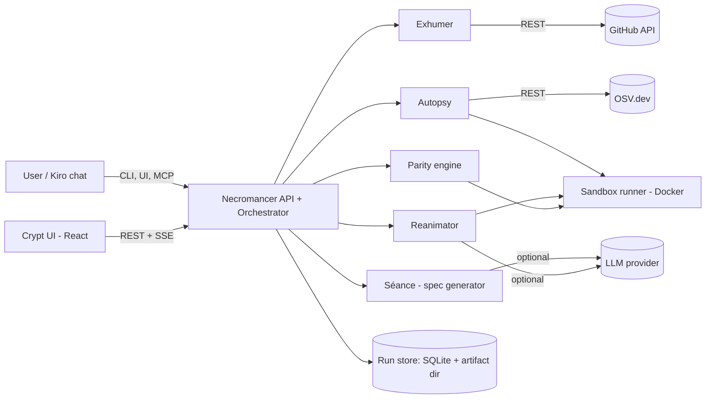

# Necromancer: End-to-End Solution Design

Companion to `PLAN.md`. This is the design for the lead idea (Resurrection). It covers the user journey, system architecture, data contracts, the core algorithms, deployment, testing, security, and the build order mapped to Kiro specs. It is a design, not built code.

---

## 1. User journeys

**J1: Live resurrection (local, CLI + UI)**
1. `necro raise https://github.com/<owner>/<dead-lib>`
2. The CLI prints the ritual stages as they run; the Crypt UI (`localhost:5173`) shows the same run live.
3. At the end: a resurrection report, a local branch `necromancer/revive`, and an optional draft PR body.

**J2: Replay (hosted, no login)**
1. A visitor opens the hosted site and picks one of 3 pre-run resurrections.
2. They scrub through the stages (autopsy, séance, reanimate, proof) and inspect specs, diffs and the parity EKG.

**J3: Kiro-native (MCP)**
1. In Kiro chat: "Revive `<owner>/<dead-lib>` and tell me what regressed."
2. Kiro calls `necromancer-mcp` tools (`exhume`, `autopsy`, `prove`) and answers from structured results.

---

## 2. System context



Design principles:
- **Deterministic first, LLM second.** Every stage has a deterministic baseline. The LLM only drafts specs and proposes patches, and the parity engine judges the result.
- **Every stage emits a typed artifact** (JSON on disk) that the UI, CLI and MCP all read. One contract, three front doors.
- **Everything runs offline from cache** so the hosted replay needs no secrets.

---

## 3. Components

| Component | Responsibility | Tech | Deterministic? |
|---|---|---|---|
| Orchestrator | Runs stages in order, persists state, streams events | Python 3.12, FastAPI, asyncio | yes |
| Exhumer | Clone repo, collect metadata, issues/PRs, CI status, manifests | `git`, GitHub REST | yes |
| Autopsy | Build + test on target toolchain; classify cause of death; CVE lookup | Docker, `pip`, pytest JSON report, OSV.dev | yes |
| Séance | Cluster issues/PRs into themes; emit Kiro-style specs | Embeddings or TF-IDF clustering, LLM for wording | baseline yes |
| Reanimator | Execute spec tasks as small patches, one commit each, re-run tests after each | LLM + rule-based fixers (pyupgrade, dependency bumps, packaging migration) | partly |
| Parity engine | Differential property-based testing, old vs new | Hypothesis, subprocess workers, two venvs | yes |
| Reporter | Resurrection report (JSON + Markdown), PR body, certificate | Jinja2 | yes |
| `necromancer-mcp` | Expose stages as MCP tools | Python MCP SDK | yes |
| CLI | `necro exhume|autopsy|seance|raise|prove|serve` | Typer | yes |
| Crypt UI | Visualise runs, specs, diffs, parity, hauntings | React + Vite + TS | n/a |

---

## 4. The pipeline (state machine)

```
EXHUMED -> AUTOPSIED -> SPEC_DRAFTED -> REANIMATED -> PROVEN -> BURIED(report)
   \__________ any stage may end in FAILED(reason) with partial artifacts kept __________/
```

Each transition writes `runs/<run_id>/<stage>.json` and appends events to `events.ndjson` (streamed to the UI over SSE).

### 4.1 Exhume
Inputs: repo URL, optional commit/tag.
Outputs (`exhume.json`): default branch, last commit date, stars, license, languages, open issues (title, body, labels, reactions), open PRs (diff stats, mergeability), dependency manifests (`pyproject.toml`, `setup.py`, `requirements*.txt`), CI config presence, a "days dead" metric.
Guards: refuse non-permissive or missing licenses unless `--allow-any-license`; cap repo size.

### 4.2 Autopsy
1. Build the sandbox image for the *original era* (Python version inferred from classifiers/CI/`python_requires`, defaulting to the oldest still available) and the *modern target* (e.g. 3.12).
2. Install and run tests in both. Capture structured results.
3. **Cause-of-death classifier** (rules, ordered):
   - `INSTALL_FAIL_DEPENDENCY` (resolver conflicts, yanked/removed pins)
   - `RUNTIME_REMOVED_API` (ImportError/AttributeError matching a table of removed stdlib or numpy/pandas APIs)
   - `PACKAGING_BROKEN` (legacy `setup.py` behaviours, missing build backend)
   - `TEST_RUNNER_BROKEN` (old pytest plugins)
   - `VULNERABLE_DEPENDENCY` (OSV advisories on pinned versions)
   - `HEALTHY_BUT_ABANDONED` (works, just stale)
4. Output (`autopsy.json`): per-environment results, causes with evidence snippets, CVE list, severity.

### 4.3 Séance (spec generation)
1. Normalise issues/PRs/CI failures into "needs".
2. Cluster by similarity (TF-IDF + agglomerative as the deterministic baseline).
3. For each cluster produce a spec folder in `.kiro/specs/` format:
   - `requirements.md`: user stories with EARS acceptance criteria ("WHEN <event> THE SYSTEM SHALL <response>"), citing source issue numbers.
   - `design.md`: approach, affected modules (from AST/import graph), risks.
   - `tasks.md`: ordered checkboxes; each task names files and the test that proves it.
4. Always include a **mandatory baseline spec** ("Run on modern Python, secure dependencies, modern packaging") derived from the autopsy, so the pipeline works even for repos with no issues.
5. Traceability: every requirement links to an issue/PR URL; the report shows coverage (% of open issues addressed vs deferred).

### 4.4 Reanimate
Loop over tasks:
1. Create a task branch state (git worktree), apply a patch (rule-based fixer first, LLM second, bounded retries).
2. Run the repo's own tests (modern env). Accept the patch only if the **test pass count does not regress** and the build succeeds.
3. Commit with message `necro(task-3): <title> [req 2.1, #142]`.
4. On repeated failure, mark the task `DEFERRED` with the reason; never silently skip.

Patch policy (steering `migration-rules.md`): minimal diffs, no public API renames without a compat shim, no test deletion, no network calls added.

### 4.5 Prove (differential parity engine)

Goal: show the revived code behaves like the original on the public API.

**API discovery**
- Import both package versions in isolated workers; walk `__all__` or public names; collect callables and classes with `inspect.signature` and type hints.
- Seed corpora from: docstring examples (doctest), existing tests' literal arguments, and type-derived strategies.

**Strategy building**
- Prefer `hypothesis.strategies.from_type` and `builds` for annotated callables; use seed-based fallback strategies for unannotated ones; skip with an explicit "uncovered" label otherwise (never fake coverage).

**Execution (per callable, N examples)**
```
for example in strategy.examples(seed=S):
    old = run_in_worker(old_env, call, example)    # returns (ok, value|exception_type, repr, duration)
    new = run_in_worker(new_env, call, example)
    classify(old, new) -> SAME | EQUIVALENT | DIVERGENT | NONDETERMINISTIC | UNCOMPARABLE
```
- Equality: structural equality with tolerant float compare; configurable normalisers (dict ordering, set ordering).
- Exceptions compared by type and (optionally) message class.
- Nondeterminism filter: call the *old* implementation twice; if outputs differ, mark `NONDETERMINISTIC` and exclude from the score.
- Shrinking: use Hypothesis shrinking on DIVERGENT cases to get minimal counterexamples.
- Side effects: opt-in snapshot of a temp working directory.

**Scoring**
```
parity_score = SAME+EQUIVALENT / (SAME+EQUIVALENT+DIVERGENT)    # NONDETERMINISTIC/UNCOMPARABLE reported separately
coverage     = callables_with_strategy / public_callables
```
Always report **both**. A high score with low coverage is shown as a warning, not a win.

**Hauntings**: each DIVERGENT group becomes a haunting with: callable, minimal counterexample, old vs new output, probable cause (diff hunk touching that callable), and a human verdict (`intentional` | `regression` | `unknown`) stored in `verdicts.json` and reflected in the final report.

### 4.6 Bury (report)
`report.md` + `report.json`: cause of death, spec coverage, tasks done/deferred, tests before/after, parity score + coverage, open hauntings, CVEs fixed, reproduction command. Includes a **reproducibility block** (seeds, image digests, tool versions) so anyone can rerun the proof.

---

## 5. Data contracts (JSON, versioned)

```jsonc
// runs/<id>/run.json
{
  "schema": "necro.run/1",
  "run_id": "2026-11-20T10-12-33Z-ab12",
  "repo": {"url": "...", "commit": "abc123", "license": "MIT"},
  "stage": "PROVEN",
  "started_at": "...", "finished_at": "...",
  "artifacts": {"exhume": "exhume.json", "autopsy": "autopsy.json",
                "specs": ["specs/baseline/", "specs/issue-cluster-1/"],
                "patches": "patches/", "parity": "parity.json", "report": "report.md"},
  "summary": {"cause_of_death": ["INSTALL_FAIL_DEPENDENCY"], "tests_before": "12/48", "tests_after": "47/48",
              "parity_score": 0.97, "coverage": 0.62, "hauntings_open": 3}
}
```

```jsonc
// parity.json (excerpt)
{
  "schema": "necro.parity/1",
  "seed": 1337, "examples_per_callable": 200,
  "callables": [
    {"name": "pkg.parse_date", "strategy": "from_type", "counts": {"same": 190, "equivalent": 6, "divergent": 4, "nondeterministic": 0},
     "hauntings": [{"id": "h1", "counterexample": {"args": ["2024-02-30"]},
                    "old": {"exc": "ValueError"}, "new": {"value": "2024-03-01"}, "verdict": "unknown"}]}
  ],
  "uncovered": ["pkg.legacy_hook"]
}
```

SQLite tables (index only; artifacts stay as files): `runs(id, repo_url, stage, created_at, summary_json)`, `events(run_id, ts, stage, level, message)`, `verdicts(run_id, haunting_id, verdict, note, ts)`.

---

## 6. Interfaces

**REST (FastAPI)**
| Method + path | Purpose |
|---|---|
| `POST /runs` `{repo_url, options}` | start a run |
| `GET /runs` / `GET /runs/{id}` | list / fetch summary |
| `GET /runs/{id}/events` (SSE) | live stage events |
| `GET /runs/{id}/artifacts/{path}` | specs, diffs, reports |
| `POST /runs/{id}/hauntings/{hid}/verdict` | mark intentional/regression |
| `GET /replay` | list bundled demo runs (read-only mode) |

**CLI**: `necro exhume|autopsy|seance|raise|prove|report|serve`, flags `--seed`, `--examples`, `--no-llm`, `--target-python`.

**MCP tools** (`necromancer-mcp`): `exhume(repo_url)`, `autopsy(run_id)`, `draft_specs(run_id)`, `prove(run_id, seed?, examples?)`, `get_hauntings(run_id)`, `set_verdict(run_id, haunting_id, verdict)`. Responses are the same JSON contracts, truncated with pointers to artifacts.

---

## 7. Crypt UI

Screens:
1. **Gate**: paste a repo URL or choose a demo; shows license + safety notes.
2. **Tombstone**: repo card with "days dead", stars, last commit, cause of death.
3. **Autopsy**: side-by-side old/new environment results; CVE list; evidence snippets.
4. **Séance**: specs rendered with requirement-to-issue links; coverage meter.
5. **Reanimation**: task list with candle-state (pending/lit/deferred), commit timeline, diff viewer.
6. **Proof of life**: parity EKG (score over callables), coverage bar, hauntings table with counterexample diff and verdict buttons.
7. **Certificate**: final report and reproduce command.

Replay mode is the same UI reading static bundles, with write actions disabled. Accessibility: AA contrast, keyboard navigation, `prefers-reduced-motion`, text alternatives for charts (data tables).

---

## 8. Sandbox and security

- All third-party code runs in **Docker with no network after dependency install**, read-only root, CPU/memory/time limits, non-root user, tmpfs scratch.
- Dependency install happens in a separate step with network limited to PyPI mirrors.
- Never execute code on the hosted site: hosted mode serves precomputed bundles only.
- Secrets: GitHub/LLM tokens come from env vars, never written to artifacts; a pre-commit hook scans for them.
- LLM prompts include only repo content already public; redact tokens/emails from logs.
- Licence gate and attribution: revived forks keep original copyright and licence text.

---

## 9. Repository layout (target)

```
necromancer/
├─ .kiro/
│  ├─ steering/{product,tech,structure,migration-rules,pbt-guidelines}.md
│  ├─ specs/{exhume-autopsy,seance-spec-gen,reanimator,parity-engine,crypt-ui,mcp-server}/{requirements,design,tasks}.md
│  ├─ hooks/{test-on-save,parity-gate,secret-scan,kiro-log}.json
│  └─ settings/mcp.json
├─ packages/
│  ├─ core/necromancer/{exhume,autopsy,seance,reanimate,parity,report,store}.py
│  ├─ sandbox/{Dockerfile.orig,Dockerfile.modern,runner.py}
│  ├─ mcp-server/server.py
│  └─ cli/necro.py
├─ apps/crypt/                 # React UI
├─ demo/{easy,medium,hard}/    # pre-run bundles
├─ docs/{SOLUTION.md,kiro-log.md,WRITEUP.md}
├─ tests/{unit,properties,e2e}/
├─ docker-compose.yml
├─ LICENSE  README.md  PLAN.md
```

---

## 10. Testing strategy

| Layer | What | Notes |
|---|---|---|
| Unit | Classifier rules, EARS formatting, equality normalisers | pytest |
| **Property-based** | (a) parity is symmetric when old == new; (b) identical implementations always score 1.0; (c) injected mutation is always detected (mutation testing the parity engine itself); (d) spec generator never drops an issue (coverage = addressed + deferred); (e) report round-trips through JSON | Hypothesis; the mutation test is the headline "we test the tester" story |
| Integration | Pipeline on a tiny synthetic dead repo checked into `tests/fixtures/` | no network |
| E2E | One real demo repo end to end in CI nightly | allowed to be slow |
| UI | Playwright smoke on replay mode + axe a11y check | |
| Reproducibility | Same seed, same score | gate in CI |

**Synthetic fixtures**: build 3 tiny "dead libs" ourselves with known planted breakages (removed stdlib API, pinned-dead dependency, behavioural change). Because we know the ground truth, we can assert that Necromancer finds the planted divergences. This is also the safest live demo.

---

## 11. Deployment

- **Local/live**: `docker compose up` (API, UI, sandbox image builder). README has a 3-command quick start.
- **Hosted replay**: static UI + bundled JSON on a static host; no backend, no secrets, no code execution.
- **CI** (GitHub Actions): lint, unit, properties, integration, UI smoke, build static replay, reproducibility check.

---

## 12. Build order mapped to Kiro specs

| Order | Spec | Deliverable | Done when |
|---|---|---|---|
| 1 | `parity-engine` | Parity on synthetic fixture #1 | detects planted divergence, ignores planted nondeterminism |
| 2 | `exhume-autopsy` | Exhume + autopsy CLI on fixtures + 1 real repo | cause-of-death correct for all 3 fixtures |
| 3 | `reanimator` | Rule-based fixers + task loop with test-regression guard | fixture revived with no test regression |
| 4 | `seance-spec-gen` | Baseline spec + issue clustering | specs valid, traceable, coverage reported |
| 5 | `mcp-server` | Tools over existing core | Kiro chat completes a run |
| 6 | `crypt-ui` | Replay mode first, then live | all 7 screens on real demo bundles |
| 7 | Polish | Demo bundles, README, video, write-up | fresh-clone test passes |

Spike gate (Nov 10): steps 1 and 2 on one fixture plus one real repo. If parity coverage on the real repo is under about 30%, narrow to type-annotated APIs and say so in the pitch.

---

## 12b. Advanced features

Characterization-test generation, mutation-based proof strength, a Skeptic agent, Kiro workspace handoff, bisect, signed certificates and more are specified, tiered and estimated in [`ADVANCED_FEATURES.md`](ADVANCED_FEATURES.md). They build on the evidence store and do not change the core pipeline.

---

## 13. Definition of done (submission)

- [ ] `.kiro/` committed with specs, steering, hooks, MCP config (not gitignored)
- [ ] OSI licence visible in the repo About
- [ ] Fresh clone: quick start works in under 10 minutes
- [ ] Hosted replay URL works with no login
- [ ] 3 demo bundles (easy, medium, honest-partial)
- [ ] Video under 3 min, public on YouTube
- [ ] `docs/WRITEUP.md`: Kiro usage across IDE/CLI/Crew, agents, hooks, specs vs vibe, steering, MCP, PBT, powers
- [ ] Blog post and `#KiroweenHackathon26` post links added to the submission
